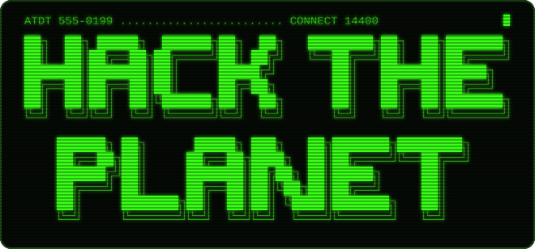

  

<i>"my crime is that of curiosity."</i> &nbsp;&mdash; The Mentor, 1986

### Building [WidgetButler](https://github.com/benburw3ll/widgetbutler)

**One brain, wired into every widget.** It tracks you, nags you, remembers what you forget, and fires rules across lights, door, sleep, meals, habits and money in combos nobody thought to wire together. You text it. It texts first.

#### Outcomes

<!-- outcomes:start -->
| Outcome | Progress | Issues |
| --- | --- | --- |
| [O1 · Decide the shape](https://github.com/benburw3ll/widgetbutler/milestone/1) | `░░░░░░░░░░` 0% | 0/5 |
| [O2 · Mac and Windows, one set of data](https://github.com/benburw3ll/widgetbutler/milestone/2) | `░░░░░░░░░░` 0% | 0/11 |
| [O3 · Always-on Telegram](https://github.com/benburw3ll/widgetbutler/milestone/3) | `░░░░░░░░░░` 0% | 0/7 |
| [O4 · Themes](https://github.com/benburw3ll/widgetbutler/milestone/4) | `░░░░░░░░░░` 0% | 0/9 |
| [O5 · Reach it from anywhere](https://github.com/benburw3ll/widgetbutler/milestone/5) | `░░░░░░░░░░` 0% | 0/6 |
| [O6 · The hub brain](https://github.com/benburw3ll/widgetbutler/milestone/6) | `░░░░░░░░░░` 0% | 0/8 |
| [O7 · Money in the hub](https://github.com/benburw3ll/widgetbutler/milestone/7) | `░░░░░░░░░░` 0% | 0/2 |
| [O8 · Ready for a second person (parked)](https://github.com/benburw3ll/widgetbutler/milestone/8) | parked | 0/5 |

**0 of 48 issues closed** (parked outcomes not counted).
<!-- outcomes:end -->

Updated automatically from the repo's milestones.
