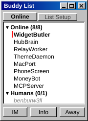
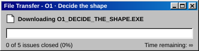
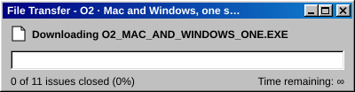
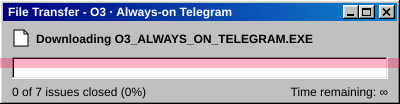
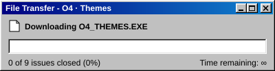
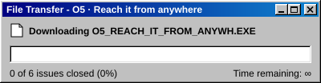
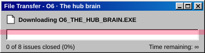
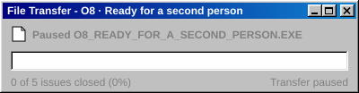

  

<i>"My crime is that of outsmarting you, something that you will never forgive me for."</i> &mdash; The Mentor, <i>The Hacker Manifesto</i>, 1986

<h3 align="center">Building <a href="https://github.com/benburw3ll/widgetbutler">WidgetButler</a></h3>

<b>One brain, wired into every widget.</b> It tracks you, nags you, remembers what you forget, and fires rules across lights, door, sleep, meals, habits and money in combos nobody thought to wire together. You text it. It texts first.

  
  

<!-- outcomes:start -->

 
 
 
 
 
 
 

<b>0 of 48 issues closed</b> (parked outcomes not counted)

<!-- outcomes:end -->

