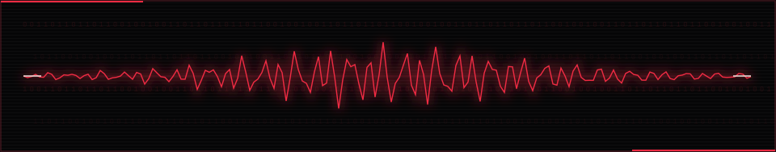
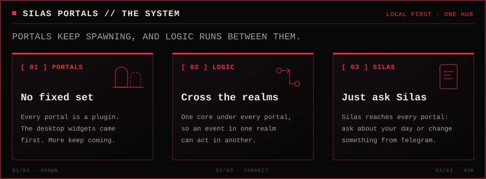

  

<b>I build personal software with an artist's eye and a dial-up soul.</b>

The 90s internet got into my head and never left: progz, screen names, modem noise, text art, dark corners of the web. I like making software that feels alive, useful, and a little uncanny.

## 01 // Current operation

I'm building **[WidgetButler](https://github.com/benburw3ll/widgetbutler)**: a Windows desktop with a butler. Eight glanceable widgets cover lights, the front door, meals, AI usage, gratitude, weight, WHOOP, and physique. A Telegram assistant can see and act through the widgets, so I can ask about my day or change something from my phone.

  

The idea is to connect things that separate apps can't: a doorbell event could trigger a light or a message. Standing “from now on…” rules already work; richer cross-widget routines are [on the roadmap](https://github.com/benburw3ll/widgetbutler#-it-doesnt-wait-to-be-asked). **WidgetButler is mid-rebuild.** The existing Windows version still runs most widgets while the new Tauri and TypeScript platform takes shape.

<a href="https://github.com/benburw3ll/widgetbutler">ENTER THE PROJECT</a> &nbsp;·&nbsp; <a href="https://github.com/benburw3ll/widgetbutler/blob/main/docs/ARCHITECTURE.md">READ THE BLUEPRINT</a> &nbsp;·&nbsp; <a href="https://github.com/benburw3ll/widgetbutler/blob/main/docs/migration/status.md">CHECK THE REBUILD</a>

## 02 // Live transmission

The build is public. These are the actual [WidgetButler outcomes](https://github.com/benburw3ll/widgetbutler/milestones), updated from GitHub milestones rather than a hand-written progress claim.

<!-- outcomes:start -->

<a href="https://github.com/benburw3ll/widgetbutler/milestone/1">O1</a> &nbsp;·&nbsp; <a href="https://github.com/benburw3ll/widgetbutler/milestone/2">O2</a> &nbsp;·&nbsp; <a href="https://github.com/benburw3ll/widgetbutler/milestone/3">O3</a> &nbsp;·&nbsp; <a href="https://github.com/benburw3ll/widgetbutler/milestone/4">O4</a> &nbsp;·&nbsp; <a href="https://github.com/benburw3ll/widgetbutler/milestone/5">O5</a> &nbsp;·&nbsp; <a href="https://github.com/benburw3ll/widgetbutler/milestone/6">O6</a> &nbsp;·&nbsp; <a href="https://github.com/benburw3ll/widgetbutler/milestone/7">O7</a> &nbsp;·&nbsp; <a href="https://github.com/benburw3ll/widgetbutler/milestone/8">O8</a>

0 of 48 active-outcome issues closed. Generated from live WidgetButler milestones; parked work excluded.

<!-- outcomes:end -->

<i>"My crime is that of outsmarting you, something that you will never forgive me for."</i> &mdash; The Mentor, <a href="https://phrack.org/issues/7/hackers-manifesto"><i>The Hacker Manifesto</i></a>, 1986

